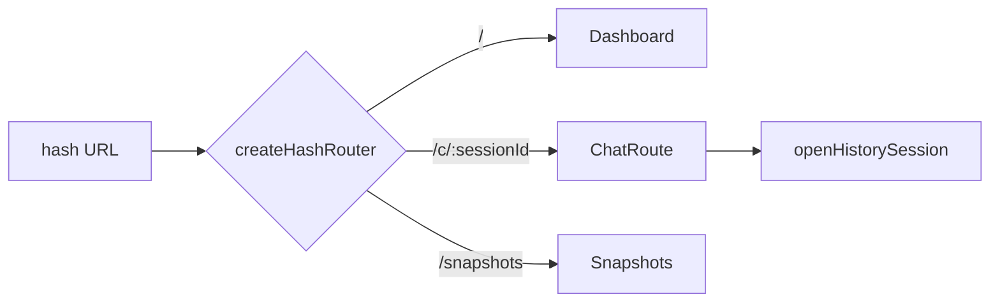

## How workspace routes are chosen

The browser client uses a **hash router**, so every route lives after the `#` and a reload never hits the server for a page. The router is built once in src/renderer/App.tsx with `createHashRouter`, and the *pane workspace* stays mounted for two of its routes.

- `/` renders the dashboard inside the workspace.
- `/c/:sessionId` renders `ChatRoute`, which opens that chat in its own project.
- `/snapshots` swaps the pane area for the router outlet.

The decision itself is one pure function, so the layout and the mobile shell can never disagree:

```typescript
export function isWorkspaceRoutePath(pathname: string): boolean {
  return pathname === '/' || pathname.startsWith('/c/')
}
```

Three call sites depend on it, and they read it for different reasons:

1. `WorkspaceLayout` decides whether to mount the panes at all.
2. `ShellFrame` hides the project chrome on routes outside the workspace.
3. `returnToWorkspaceRoute` wraps the check and navigates to `/` when it fails.

| Route | Component | Panes mounted |
| --- | --- | :---: |
| `/` | `WorkspaceDashboard` | yes |
| `/c/:sessionId` | `ChatRoute` | yes |
| `/snapshots` | `WorkspaceSnapshots` | no |
| anything else | `NotFound` | no |

> The chat route is a *restore* mechanism, not a view. On reload the session reopens from the URL before the workspace record loads, which avoids the "no active chat" race.



The router docs cover the hash variant in more depth: [createHashRouter](https://reactrouter.com/en/main/routers/create-hash-router).

I replaced the prefix check with an anchored pattern. A chat route now needs exactly one non-empty segment after `/c/`, so `/c/` and `/c/a/b` fall through to the router outlet.

### Result

All **6** route tests pass. To check it yourself:

```bash
bun vitest run src/renderer/lib
rg -n "CHAT_ROUTE" src/renderer/lib
```

- [x] Reject `/c/` with no id
- [x] Reject nested paths under `/c/`
- [ ] Add a test for a percent-encoded session id
Plan saved.
```termul-plan
{"entries":[]}
```
See ./src/lib/x_y.ts:12 and .
